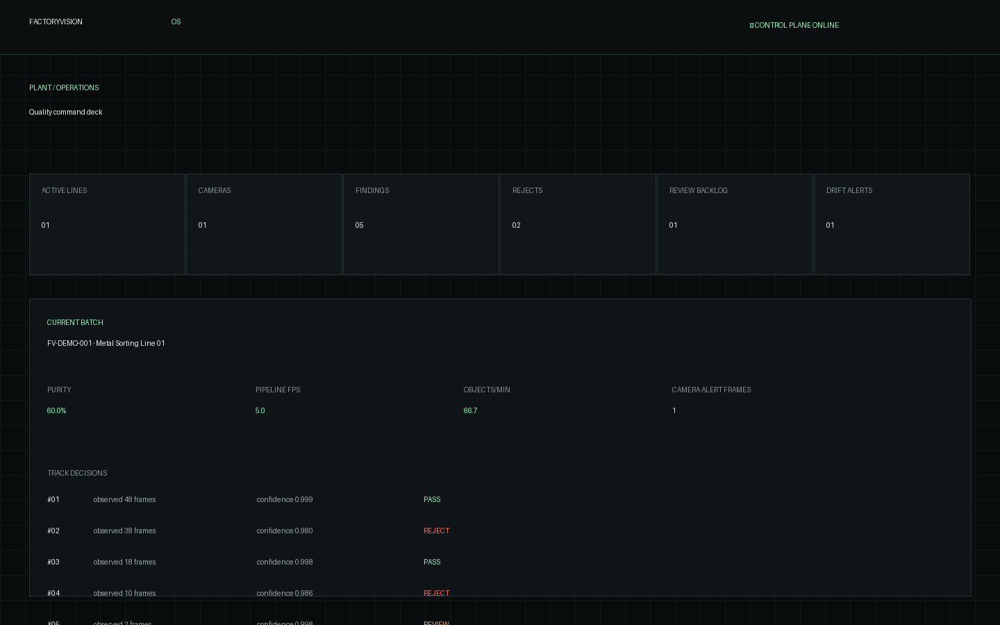
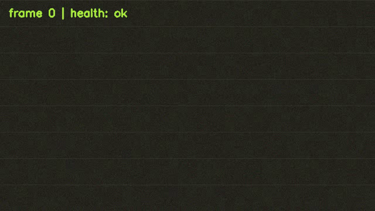

# FactoryVision OS

**FactoryVision OS** is an Apache-2.0 industrial visual-inspection control plane and CPU-first reference implementation for conveyor sorting, anomaly inspection, sequential video decisions, human review, traceability, model lifecycle and edge deployment.

> The included demo performs real training and inference. Its small dataset is deterministically generated and explicitly labelled as a smoke-test—not as production accuracy. Full-scale adapters document SteelDS, VisA, AeBAD and the noncommercial MVTec AD boundary.

## What runs today

- supervised three-class pixel segmentation (background, steel, copper)
- one-class feature-memory anomaly detection
- video ingestion, camera-quality checks, stable track IDs and temporal aggregation
- pass/review/reject decisions, purity and throughput calculations
- evidence frames, overlay video and five PDF operational/reporting outputs
- SQLAlchemy domain model, tenant-scoped FastAPI API and API-connected Next.js operations UI source
- model/dataset/experiment/deployment/drift/audit records
- simulated MQTT reject event with an explicit safety boundary

## Real generated demo visuals





## Generated inspection result

After `make demo`, inspect:

- `artifacts/runs/demo/overlay.mp4`
- `artifacts/runs/demo/evidence/`
- `artifacts/reports/batch_FV-DEMO-001.pdf`
- `artifacts/demo_summary.json`

## Quick start

```bash
python -m venv .venv
. .venv/bin/activate      # Windows: .venv\Scripts\activate
pip install -e .[dev]
make demo
uvicorn apps.api.main:app --reload
```

Open API docs at `http://localhost:8000/docs`. Demo credentials: `admin@factoryvision.local` / `factoryvision`.

## Docker

```bash
docker compose up --build
```

Web: `http://localhost:3000`; API: `http://localhost:8000`; MLflow: `http://localhost:5000`; MinIO console: `http://localhost:9001`.

## Data commands

```bash
factoryvision data list
factoryvision data validate steelds
factoryvision data download visa --out datasets/raw
```

See [dataset licensing](docs/DATASETS.md) and the compact [dataset link index](docs/DATASET_LINKS.md). MVTec AD is research-only because its official license explicitly forbids commercial use.

## Real Dataset and Bounding-Box Sources

The runnable demo still uses generated conveyor data so the repository can run without downloading large third-party archives. For real-data training and evaluation, FactoryVision OS now documents these verified sources:

| Dataset | What to download | Annotation type | FactoryVision use |
|---|---|---|---|
| [SteelDS](https://zenodo.org/records/20271102) | Zenodo archives `a1.zip` through `a5.zip` (67.6 GB total) | YOLO bounding-box labels plus instance segmentation/material labels | Primary real conveyor source for steel/copper detection, tracking and sorting workflows |
| [SteelDS baseline](https://github.com/MelanieNeubauer/SteelDS_Baseline) | Baseline code and `data_a*.yaml` examples | Confirms expected `images/` and `labels/` layout with YOLO text labels | Reference layout for plugging SteelDS into YOLO/Mask R-CNN adapters |
| [Steel Defects on Roboflow Universe](https://universe.roboflow.com/hamdi-ali-akgungor/steel-defects-xbfez) | Manual Roboflow export, preferably YOLO or COCO | 2,294 object-detection images, 12 classes, CC BY 4.0 | Lightweight bounding-box source for smoke-testing detector adapters |
| [Amazon VisA](https://registry.opendata.aws/visa/) | `VisA_20220922.tar` from AWS Open Data | Image labels and pixel-level anomaly masks | Real anomaly segmentation benchmark; not a bounding-box dataset |

Raw third-party datasets are intentionally not committed. Download them into `datasets/raw/`, preserve their license/citation files, and record local checksums before training.

## Training and evaluation

`make demo` trains the supervised baseline on labelled pixels, trains the one-class model on normal images, evaluates both on held-out samples and stores the actual metrics. Production adapters can replace these models without changing the tracker, decision engine, API or review workflow.

## Architecture

See [docs/ARCHITECTURE.md](docs/ARCHITECTURE.md) for six implementation-aligned Mermaid diagrams. The main path is camera/video → quality validation → model → tracker → temporal gate → pass/review/reject → evidence + traceability.

## API examples

```bash
curl http://localhost:8000/dashboard -H 'X-Tenant-ID: demo-manufacturing'
curl http://localhost:8000/findings -H 'X-Tenant-ID: demo-manufacturing'
```

## Repository map

```text
apps/api          FastAPI entrypoint and image
apps/web          Next.js industrial operations interface
apps/worker       batch/video worker entrypoint
factoryvision/cv  models, quality, tracking and temporal pipeline
factoryvision     domain, API, security, reports and demo orchestration
datasets          machine-readable registry
docs              research, licensing, architecture, MLOps and deployment
infra             edge and observability configuration
tests             model, tracking, API, isolation and report tests
```

## Benchmarks

Metrics are not hard-coded. Run `make demo` to regenerate `artifacts/demo_summary.json`. The README intentionally does not publish fixed accuracy numbers that could become disconnected from the current implementation or machine.

## Edge exports

Install `.[edge]` to regenerate the ONNX model and execute the CPU benchmark under ONNX Runtime and OpenVINO. Results are written to `artifacts/benchmarks/edge_benchmark.json`; they are machine-specific. If the optional extra is not installed, the demo records the missing dependency and release validation accepts that explicit boundary without claiming an edge benchmark. The execution-provider boundary allows future CUDA/TensorRT adapters to share the same decision and evidence pipeline.

## Security

See [docs/SECURITY.md](docs/SECURITY.md). The demo uses salted PBKDF2 password hashes, expiring signed tokens, tenant-scoped queries, audit events and private-artifact paths. Plant actuation is simulated unless a reviewed integration is explicitly enabled.

## License

Software: Apache License 2.0. Dataset licenses remain independent. SteelDS and VisA are CC BY 4.0; MVTec AD is CC BY-NC-SA 4.0 and is not a commercial demo dependency.

## Roadmap

- ByteTrack/BoT-SORT production tracker plugin
- Mask R-CNN/YOLO segmentation adapters for SteelDS
- INT8 calibration set tooling and target-device acceptance profiles
- OPC-UA information model and hardware-in-the-loop test harness
- WebSocket live console and signed evidence URLs

Contributions are welcome; see [CONTRIBUTING.md](CONTRIBUTING.md).

---

## Phase 2 — v0.2.0

Phase 2 preserves the original deterministic CPU demo and adds production-oriented framework components:

- Durable SQLite edge queue with idempotent synchronization
- SHA-256 model validation, smoke activation and rollback
- IndustrialEvent schema v1 with correlation and idempotency identity
- MQTT-ready offline publisher and isolated OPC-UA result simulator
- Explainable product-level temporal decisions with persistence, review band, locking and override
- Model release gates with passed, failed, waived and missing-evidence states
- Population Stability Index drift calculations
- Camera freeze, blur, exposure, contrast and FPS health rules
- Video-file live camera simulator
- Dataset, model, workflow and integration plugin interfaces
- Expanded governance, threat-model, contributor and supply-chain documentation

### Evidence status

The shipped runnable model and media demo still uses project-generated synthetic conveyor data. No new real public dataset evaluation was completed in this execution environment, and FactoryVision OS is not production certified. Dataset links and licence boundaries are documented so contributors can run legally appropriate real-data validation separately.

### Phase 2 validation

```bash
pytest -q                       # 12 tests
python -m compileall -q factoryvision
python scripts/validate_release.py
```

Docker startup and the Next.js production build must be run on a host with Docker and successful npm registry access; see `docs/VALIDATION_REPORT.md`.
